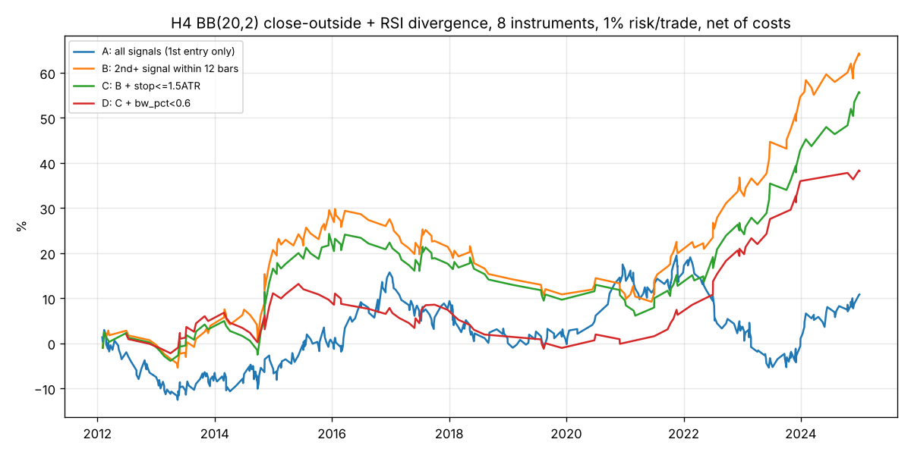

> **2026-11-03 追記（重要）: この報告書の結論は、その後の検証で覆りました。**
> 3章で提案した H4 ルールは、設計に使っていない10通貨（クロス通貨）では平均 −0.17R、未使用期間の 2005〜2011年でもマイナスでした。
> このルールで EA を作ることは推奨しません。最終的な結論は `FINAL_SUMMARY.md` を参照してください。

# ボリンジャーバンド±2σ × RSIダイバージェンス シグナルの検証と EA 設計の検討

作成日: 2026-11-03
対象: X（旧Twitter）投稿「ボリバンの±2σタッチかつRSIダイバージェンスの所だけサインが出るインジ」の有用性検証と、EA化する場合の設計方針

---

## 0. 結論（先に要点）

1. **M15・H1 では、このシグナルはコスト控除後に優位性がない。** 主要7通貨ペア＋ゴールド、2012〜2024年の13年間で、シグナル定義16通り × 決済ルール4通りの全組み合わせが H1 で純損益マイナス（最良で −0.003R）。M15 はさらに悪い（平均 −0.12R）。X投稿の「めちゃくちゃ効く」は、後から見た2枚のチャートの印象であり、データでは再現できない。
2. **H4 でのみ、条件を絞れば小さな優位性が残る。** 「ヒゲのタッチ」ではなく「終値がバンド外」、RSIの乖離が5pt以上、という条件で平均 +0.12R（重複シグナル込み、652回）。ただし EA として現実的な「1銘柄1ポジション」にすると +0.03R（437回）まで落ち、統計的にゼロと区別できない。
3. **「最初のシグナルは見送り、12本（48時間）以内の2回目以降のシグナルで入る」ルールが最も安定していた。** 2回目以降は平均 +0.29R（180回、t値 2.7、前半・後半とも正）。ストップ幅を1.5ATR以下に制限すると平均 +0.33R、141回／13年（8銘柄合計で年11回程度）。
4. **それでも、単独 EA としては弱い。** 1トレード 1% リスクで年率 3.5%、最大ドローダウン 14.6%。2016〜2021年の約5年間は資産曲線がほぼ横ばい〜微減。「ドローダウンをできる限り小さく」という要件に対しては、このシグナル単独では不十分と判断する。
5. **RSIダイバージェンスの部分には情報がある**（H4 で、同じ「終値がバンド外＋安値更新」でもダイバージェンスなしは −0.06R、ありは +0.12R）。バンドタッチだけのロジックには情報がない。EA を作るなら「ダイバージェンス」を核に、バンドは場所のフィルターと位置付けるべき。

---

## 1. データと前提

| 項目 | 内容 |
|---|---|
| データ | histdata.com の1分足（Generic ASCII）。GitHub の FX-1-Minute-Data プロジェクトが公開している Google Drive ミラーから取得 |
| 銘柄 | EURUSD, GBPUSD, USDJPY, AUDUSD, USDCAD, USDCHF, NZDUSD, XAUUSD |
| 期間 | 2012-01 〜 2024-12（13年） |
| 時間軸 | 1分足から M15 / H1 / H4 / D1 を生成。タイムスタンプは histdata の EST（UTC−5、夏時間なし） |
| コスト | 往復（スプレッド＋スリッページ）を固定で控除。EURUSD 1.0pip、GBPUSD 1.5、USDJPY 1.0、AUDUSD 1.2、USDCAD 1.8、USDCHF 1.8、NZDUSD 1.8、XAUUSD 0.30ドル |
| 検証期間の分割 | IS（インサンプル）2012〜2018年、OOS（アウトオブサンプル）2019〜2024年 |
| 成績の単位 | R（1トレードのリスク＝エントリーとストップの距離を1とした損益）。銘柄間で比較できるように統一 |

**シグナルの定義**（投稿者の厳密な定義は不明なので、一般的な定義で実装した）

- ボリンジャーバンド(20, 2σ, 終値)、RSI(14, Wilder方式)、ATR(14)
- 買い: (a) 足がバンド下限に触れる（ヒゲ版: 安値 ≤ 下限、終値版: 終値 ≤ 下限）、(b) その足の安値が直近 L 本（3本前〜L本前）の最安値を下回る、(c) その足の RSI が最安値の足の RSI より margin pt 以上高い。売りは鏡像
- エントリー: シグナル足の翌足の始値
- ストップ: シグナル足の安値（高値）から 1.0 ATR 外側
- 利確: シグナル時点のバンド中心線（固定）
- 時間切れ: 32本で成行決済

ルックアヘッド（未来参照）が入らないよう、すべての指標はその足の確定値のみで計算している。上位足（H4・D1）の特徴量も、確定済みの足のみを参照する。

---

## 2. 検証結果

### 2.1 M15 / H1: 優位性なし

**シグナル後の先行リターン（ATR単位、コスト前）**

M15 でプールした結果（8銘柄合計）。シグナル（タッチ＋ダイバージェンス）と、ダイバージェンスなしのタッチだけを比べても差がない。

| 条件 | N | 8本後 | 16本後 | 32本後 |
|---|---|---|---|---|
| タッチ＋ダイバージェンス（買い） | 62,921 | +0.004 | +0.02 | +0.03 |
| タッチのみ、ダイバージェンスなし（買い） | 292,436 | +0.057 | +0.05 | +0.05 |

M15 の ATR は EURUSD で 5〜8pips。+0.03 ATR ≒ 0.2pip であり、スプレッドを下回る。

**トレードシミュレーション（コスト後）**

| 時間軸 | 決済ルール | N | 勝率 | 平均R | PF |
|---|---|---|---|---|---|
| M15 | 中心線TP / 1ATR SL / 32本 | 120,058 | 53% | −0.12 | 0.76 |
| H1 | 同上 | 29,223 | 53% | −0.06 | 0.87 |

8銘柄すべて、買い売りともマイナス。H1 でシグナル定義16通り × 決済4通り（64組）を総当たりしても、純損益が正になる組み合わせはゼロ（最良 −0.003R）。コストをゼロにしても H1 の粗利益は +0.01〜+0.05R 程度しかない。

「2回目のシグナルで入る」ルール（後述、H4 で有効）を H1・M15 に適用しても、依然としてマイナス（H1: −0.02R、M15: −0.11R）。

**結論: 投稿と同じ M15、および H1 では、このインジケーターに基づく EA は作らない方がよい。**

### 2.2 H4: 条件を絞れば小さな優位性

H4 で同じ総当たりを行うと、「終値がバンド外」かつ「RSI 乖離 margin ≥ 5」の組み合わせが上位に並ぶ。

| 設定（H4, TP=中心線, SL=1ATR, 32本） | N | 純平均R | 粗平均R | IS | OOS | 勝率 | 正の銘柄数 |
|---|---|---|---|---|---|---|---|
| 終値外, L=100, margin=5 | 652 | +0.116 | +0.152 | +0.05 | +0.19 | 45% | 7/8 |
| 終値外, L=60, margin=5 | 649 | +0.143 | +0.178 | +0.09 | +0.19 | 47% | 7/8 |
| ヒゲタッチ, L=40, margin=0（投稿に近い定義） | 7,036 | −0.032 | −0.001 | −0.02 | −0.05 | 52% | 2/8 |

パラメータの安定性: L（60/100/150）と時間切れ（24/32/48本）にはほぼ感度がなく、margin 5〜10、SL 1.0〜1.5 ATR の範囲はすべて正。margin 8 以上は IS がマイナスで OOS だけが大きく、サンプルも少ない（300回未満）ため、margin=5 を基準にした。

**ダイバージェンスの寄与**（H4、同じ決済ルール）

| エントリー条件 | N | 純平均R |
|---|---|---|
| A: 終値外 ＋ ダイバージェンス（5pt） | 652 | **+0.116** |
| B: 終値外のみ | 20,332 | −0.053 |
| C: 終値外 ＋ 安値更新、ただし RSI も更新（ダイバージェンスなし） | 7,397 | −0.062 |
| D: 終値外 ＋ RSI<30 / >70 | 7,616 | −0.059 |
| F: ヒゲタッチ ＋ ダイバージェンス（5pt） | 2,276 | +0.009 |

A と C の差がダイバージェンスの価値。バンド外・RSI極値・安値更新だけでは全部マイナス。ヒゲでの判定（F）だと価値がほぼ消える。

### 2.3 「1銘柄1ポジション」にすると消える → 2回目のシグナルが本体

上の 652 回はシグナルの重複を許した集計。EA として「ポジション保有中は新規シグナルを無視」にすると、

| ルール | N | 平均R | t値 |
|---|---|---|---|
| 全シグナル（保有中は無視） | 437 | +0.031 | 0.5 |

とほぼゼロになる。原因を分けると、同じ方向のシグナルが直近12本以内に何回目かで成績が大きく違う。

| 直近12本以内の同方向シグナル回数 | N | 平均R | 勝率 | IS | OOS | t値 | 最大DD(R) |
|---|---|---|---|---|---|---|---|
| 0（クラスターの最初） | 417 | +0.03 | 44% | +0.01 | +0.06 | 0.5 | −28.7 |
| 1（2回目） | 179 | **+0.29** | 49% | +0.15 | +0.51 | 2.8 | −9.3 |
| 2以上 | 56 | +0.18 | 43% | +0.10 | +0.29 | 0.9 | −7.1 |

解釈: 1回目のダイバージェンスは「まだ落ち切っていない」ことが多く、さらに安値を更新しながら RSI は切り上がる（2回目）ところで反転しやすい。いわゆる「ダブル・ダイバージェンス」で、ロジックとしても自然であり、IS/OOS とも正。

### 2.4 最終ルール案（H4）の成績

ルール C: 「終値がバンド外 ＋ RSI乖離5pt以上 ＋ 直近12本以内の2回目以降のシグナル ＋ ストップ幅 ≤ 1.5 ATR」、1銘柄1ポジション、同時最大4ポジション。

| 指標 | 値 |
|---|---|
| トレード数 | 141（13年、8銘柄合計 → 年11回程度） |
| 平均R / 勝率 | +0.33R / 47% |
| 利確時 平均 +1.9R、損切り時 平均 −1.04R | TP 63回、SL 73回、時間切れ 5回 |
| 合計 | +45.8R |
| 最大ドローダウン | −15.4R（1%リスクで −14.6%、0.5%で −7.5%） |
| 年率（1%リスク、複利） | 3.5% |
| 損益がマイナスの年 | 2012, 2017, 2018, 2019, 2020（2017〜2019 累計 −10.7R） |
| 銘柄別 | USDCAD のみマイナス（−4.8R）。EURUSD +20.1R が最大 |
| コストを2倍にした場合 | 平均 +0.29R（優位性は残る） |
| トレード順序をシャッフルしたモンテカルロ（1%リスク） | 最大DD 中央値 −8.4%、下位5% −13.2% |



資産曲線を見ると、2016年〜2021年は約5年間ほぼ横ばい。ドローダウン重視の要件に対しては、これ単独では満たさない。

### 2.5 「取引しない条件」の分析（H4、652回ベース）

特徴量ごとに3分位で平均Rを比較した。IS/OOS で符号が一致したものだけを採用候補にした。

| 特徴量 | 悪い領域 | 良い領域 | 採用 |
|---|---|---|---|
| バンド幅の百分位（直近200本） | 上位1/3: −0.03R（IS −0.01 / OOS −0.06） | 下位2/3: +0.15〜+0.19R | ○ 任意（トレード数が大きく減る） |
| シグナル足のレンジ / ATR | >1.7 ATR: +0.02R | <1.0 ATR: +0.25R | ○（ストップ幅上限 1.5 ATR として実装） |
| ストップ幅（ATR） | >1.44 ATR: +0.01R | <1.2 ATR: +0.25R | ○ 同上 |
| D1 トレンド整合（SMA20 からの距離） | トレンド方向への押し目買い: +0.04R | 深い逆行（極端な行き過ぎ）: +0.22R | × 直感と逆。「行き過ぎからの反発」が本質なので、順張りフィルターは入れない |
| ATR 比率（直近200本平均比） | 中間: −0.01R | 低位: +0.28R | × 単調でないため不採用 |
| 曜日 | 月・水が IS でマイナス | 火が良い | × IS/OOS で不一致、理由もない |
| 時間帯 | 20:00 EST 足（アジア早朝）が OOS でマイナス | 16:00 EST 足が最良 | △ 参考程度（N が小さい） |
| バンド外の連続本数 | 4本以上: −0.1R | 1本: +0.16R | △ 2回目ルールと重なる |

---

## 3. EA 設計の提案

### 3.1 前提となる判断

- **M15 / H1 ではこのロジックで EA を作らない。** 作っても手数料負けする。
- H4 で作る場合も、「利益の柱」ではなく「複数戦略のうちの一つ」として位置付ける。単独では年率数%・DD 15% 前後が現実的な期待値。
- 投稿のチャートにある「ヒゲのタッチ」ではなく「終値がバンド外」で判定する。

### 3.2 エントリーロジック（H4、全主要通貨＋ゴールド、買い売り両方）

```
各 H4 足の確定時:
  BB(20,2σ,close), RSI(14), ATR(14) を確定足で計算
  買い候補:
    close <= lower_band
    かつ low < min(low[3..100 本前])             … 直近の安値を更新
    かつ RSI > RSI[その最安値の足] + 5           … RSI は切り上げ（強気ダイバージェンス）
  売り候補: 鏡像（close >= upper_band, high > max(high[3..100]), RSI < RSI[最高値足] − 5）

  候補が出たら「同方向の候補が直近 12 本以内に既にあったか」を確認
    なければ → 記録だけして見送り（取引しない）
    あれば   → エントリー条件へ

エントリー条件:
    risk = |entry − stop| が 1.5 ATR 以下（超えるなら見送り）
    stop = シグナル足の安値 − 1.0 ATR（買い）/ 高値 + 1.0 ATR（売り）
    TP   = シグナル時点の BB 中心線（固定）。TP までの距離がコスト以下なら見送り
    次の足の始値で成行
決済: TP / SL / 32 本経過で成行
```

### 3.3 取引しない条件（重要度順）

1. **クラスターの1回目のシグナル**: 直近12本以内に同方向シグナルがなければ入らない。これが最大の差（+0.03R → +0.29R）。
2. **ストップ幅が 1.5 ATR を超える**（シグナル足が大陽線・大陰線）: ニュースやクライマックスの足で、反転より継続が多い。
3. **ポジション保有中の同銘柄**: 1銘柄1ポジション。ナンピン・追加は検証していない（しない）。
4. **ポートフォリオ上限**: 同時 4 ポジションまで。相関の高い USD 絡みが同時に点灯しやすいため、総リスクを「口座の 2〜4%」で上限管理。
5. **バンド幅が直近200本の上位40%**（任意）: 採用するとトレード数が 141 → 92 に減り、最大DD は −15.4R → −13.4R。IS では効果が弱いので、まず入れずに運用し、フォワードで判断するのが妥当。
6. **スプレッド異常時**: 現在スプレッドが通常の 2 倍超（ロールオーバー、休日、指標直後）なら発注しない。データでは検証不可だが、コスト感応度（コスト2倍で平均 −0.04R）から見て合理的。
7. **重要指標の前後**: 本検証では経済指標データが取れていないので未検証。EA には「指標の前後 N 分は新規なし」のスイッチを付け、フォワードで ON/OFF を比較する。
8. **資産曲線の非常停止**: ピークから −10%（1%リスク時）で新規停止し、人が確認する。バックテストの最大DDが −14.6% なので、−10% は「想定内だが要確認」の水準。

以下は**データで支持されなかった**ため入れない: 上位足トレンド方向への限定（逆効果）、曜日フィルター、RSI 30/70 の閾値（ダイバージェンスの代替にならない）。

### 3.4 資金管理

- 1トレードのリスク: 口座の 0.5%（最大DD 約 7.5%）〜 1%（約 15%）。要件が「DDを小さく」なら 0.5%。
- ロット = 口座残高 × リスク率 ÷（ストップ距離 × 1pipの価値）。ATR ベースでストップ距離が変わるので、固定ロットは不可。
- 期待トレード数は年 10〜15 回（8銘柄合計）と少ない。評価には最低 2〜3 年のフォワードが必要。

### 3.5 実装上の注意（MT5）

- **H4 の足の区切り**がブローカーのサーバー時間（多くは GMT+2/+3）で決まり、本検証の EST 区切りとは 1〜3 時間ずれる。H4 ではこのずれでシグナルが変わるので、実装後に MT5 のストラテジーテスターで本検証と同程度の成績が出るか必ず確認する。
- iBands の標準偏差は母標準偏差（本検証と同じ）。RSI は Wilder 方式（iRSI と同じ）。
- 判定は確定足（shift=1）のみで行い、形成中の足は使わない。divergence 系の市販インジケーターは「後から表示が変わる（リペイント）」ものが多いので、自作して確定足だけで判定する。
- `ea/BBRsiDiv_H4_spec.md` に MQL5 の骨子を置いた（MT5 環境がないため未コンパイル・未検証）。

---

## 4. この検証の限界

- データは1社（histdata）の M1 で、約定はバー単位の近似。スプレッド変動・スリッページは固定値で代替。
- パラメータ（終値判定、margin=5、12本以内の2回目）は同じデータから選んでいる。IS/OOS ともに正ではあるが、選択バイアスは残る。141 回のトレードから得た t値 2.6 は「偶然ではなさそう」程度で、確信できる水準ではない。
- 2017〜2019 年のように 3 年連続でマイナスの期間があり、「効かない期間が数年続く」ことは前提にする必要がある。
- 経済指標カレンダーは取得できなかったため、指標フィルターの効果は未検証。

---

## 5. 再現方法

`research/README.md` を参照。`research/out/` に集計 CSV と最終ルールのトレード一覧（`trades_final_h4_ruleC.csv`）を置いている。
