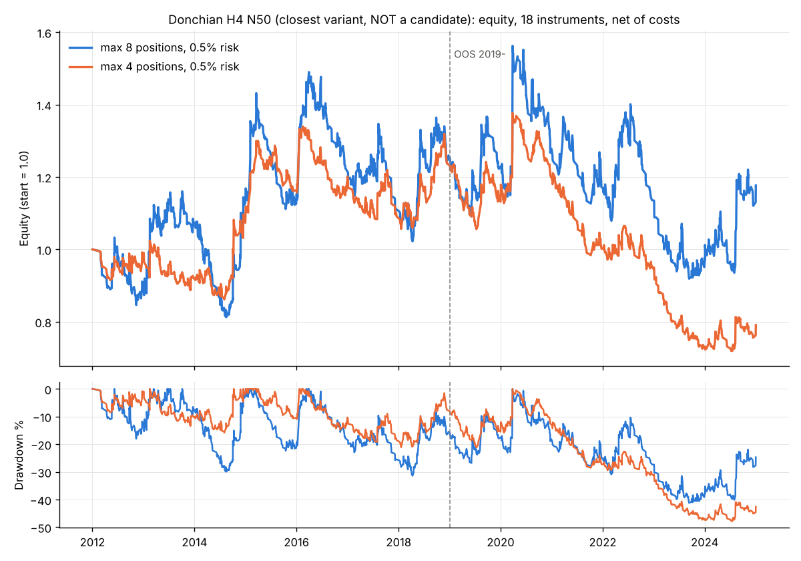

# FX 戦略ファミリー検証レポート（MT5 EA 候補探索）

作成日: 2026-11-03　対象データ: histdata 2012-01〜2024-12（AUDJPY は 2012-10〜）、18 銘柄、時刻は EST（UTC-5、夏時間なし）

## 1. 結論

- **事前に固定した 5 つの判定基準をすべて満たす「候補」は 0 件でした。** 7 ファミリー 26 バリエーションと、参考行（H4 ダイバージェンス）の計 27 行を検証し、全行が不合格です。
- 全行が満たしたのは「取引数 100 以上」（基準④）だけです。基準①（4 区分すべてで平均R がプラス）、②（t 値 2.0 以上）、③（合計R ÷ 最大DD ≥ 3）、⑤（18 銘柄中 12 銘柄以上で黒字）は、どの行も満たしませんでした。
- いちばん近かったのは **H4 の Donchian ブレイクアウト（N=50、25 本チャネルで決済、初期 SL 2ATR）** です。ただし、そのプラスは主に次の 2 つから来ています。
  1. 円安局面（2012〜15 年、2021〜24 年）でクロス円を買った取引。円クロスの買いだけで +252R、それ以外の銘柄の買いは −127R でした。
  2. 2015-01-15 のスイスフラン・ショック（SNB）で EURCHF の売りが +153R になった 1 取引。この取引を除くと t 値は 0.91 から 0.34 に下がります。また実際の約定がこのとおりになったとは考えにくい取引です。
- 「取引しない条件」のうち 4 区分で効果の向きが一致したもの（ATR 比 0.8 未満は見送り、月間 −5R で新規停止）を加えても、t = 1.64、合計R/DD = 2.50 で基準に届きません。SNB 取引を除くと t = 1.41、比 1.37 に下がります。
- このルールを 18 銘柄のポートフォリオで運用した場合（1 取引 0.5% リスク、最大同時 8 ポジション）、13 年間の年率は +1.3%、最大DD は −41%、新高値を更新できなかった最長期間は 55 か月でした。コストを 1.5 倍にすると年率はマイナスになります。**実運用の EA にすることは勧めません。**
- 今回のデータとコスト前提では、標準的なテクニカル系ルール（トレンドフォロー、モメンタム、短期逆張り、スクイーズ、押し目買い、セッションブレイク）に、銘柄や期間を問わない安定した優位性は確認できませんでした。

## 2. 事前に固定した判定基準

結果を見る前に固定し、あとから変更していません。コストは 1 往復あたり COST_PIPS（bt.py の値をそのまま使用。例: EURUSD 1.0pips、GBPJPY 2.5pips、XAUUSD 30 セント）を毎取引差し引いています。1 銘柄につき同時に持つポジションは 1 つまでです。R = 損益 ÷ 初期リスク（エントリー価格と初期 SL の差）。

| # | 基準 |
|---|---|
| ① | 平均R が 4 区分（設計 8 銘柄×IS 2012-2018、設計×OOS 2019-2024、検証 10 銘柄×IS、検証×OOS）のすべてでプラス |
| ② | 18 銘柄をまとめた t 値が 2.0 以上 |
| ③ | 2012〜2024 年をまとめた合計R ÷ 最大DD(R) の絶対値 が 3 以上（累積 R は決済時刻の順に並べる） |
| ④ | 18 銘柄をまとめた取引数が 100 以上 |
| ⑤ | 18 銘柄中 12 銘柄以上で合計R がプラス |

設計グループ: EURUSD GBPUSD USDJPY AUDUSD USDCAD USDCHF NZDUSD XAUUSD
検証グループ: EURJPY GBPJPY EURGBP AUDJPY EURAUD EURCHF CADJPY AUDNZD NZDJPY GBPCHF

### 共通の約定ルール（先読みなし）
- シグナルは確定した足で判定し、次の足の始値でエントリーします。
- SL は足の途中でも判定します。窓開けで SL を飛び越えた場合は、その足の始値で約定したものとして扱います（不利な側）。
- トレーリング（Chandelier 型）: 買いなら「エントリー後の最高値 − 3×ATR(14)」まで、足の確定ごとに SL を引き上げます。引き上げた SL は次の足から有効です。
- 決済シグナル（反対クロス、チャネル割れ、RSI 条件など）は足の確定で判定し、次の足の始値で決済します。
- D1 のトレンドを H4 で使うときは、D1 足の確定時刻を基準に merge_asof（backward）で揃えています。
- パラメータは指示書の標準値をそのまま使いました。調整はしていません。スクイーズの「直近」は「過去 10 本以内に bw_pct ≤ 0.10 があった」と、結果を見る前に決めました。セッションブレイクのレンジは 19:00〜02:00 EST、ブレイク判定は 02:00〜07:00 開始の H1 足（1 日 1 回まで）、決済は 16:00 足の終値（17:00 EST）です。

## 3. 戦略ファミリー別の結果（全 18 銘柄、コスト控除後）

表の見方: 設計IS／設計OOS／検証IS／検証OOS は各区分の平均R です。「黒字銘柄」は合計R がプラスだった銘柄の数です。

| 戦略 | N | 平均R | 設計IS | 設計OOS | 検証IS | 検証OOS | t値 | 合計R | 最大DD(R) | 合計R/DD | 黒字銘柄 | ①4区分 | ②t≥2 | ③比≥3 | ④N≥100 | ⑤≥12銘柄 | 判定 |
|---|---:|---:|---:|---:|---:|---:|---:|---:|---:|---:|---:|:-:|:-:|:-:|:-:|:-:|:-:|
| F1 Donchian / N20 exit chan10 / D1 | 1979 | -0.044 | -0.021 | -0.045 | -0.013 | -0.100 | -1.36 | -88 | -147 | -0.60 | 9/18 | × | × | × | ○ | × | 不合格 |
| F1 Donchian / N20 exit trail3 / D1 | 2036 | -0.001 | +0.028 | -0.005 | +0.038 | -0.065 | -0.02 | -1 | -92 | -0.01 | 10/18 | × | × | × | ○ | × | 不合格 |
| F1 Donchian / N55 exit chan27 / D1 | 948 | -0.074 | +0.175 | -0.111 | -0.105 | -0.230 | -1.03 | -70 | -159 | -0.44 | 6/18 | × | × | × | ○ | × | 不合格 |
| F1 Donchian / N55 exit trail3 / D1 | 1178 | -0.006 | +0.118 | -0.068 | -0.002 | -0.065 | -0.14 | -7 | -77 | -0.09 | 8/18 | × | × | × | ○ | × | 不合格 |
| F1 Donchian / N50 exit chan25 / H4 | 5992 | +0.034 | -0.002 | +0.007 | +0.122 | -0.010 | 0.91 | 204 | -228 | 0.90 | 10/18 | × | × | × | ○ | × | 不合格 |
| F1 Donchian / N50 exit trail3 / H4 | 7914 | +0.016 | +0.011 | -0.000 | +0.063 | -0.021 | 0.65 | 126 | -221 | 0.57 | 10/18 | × | × | × | ○ | × | 不合格 |
| F1 Donchian / N100 exit chan50 / H4 | 3717 | -0.011 | +0.004 | +0.005 | +0.027 | -0.084 | -0.28 | -43 | -273 | -0.16 | 8/18 | × | × | × | ○ | × | 不合格 |
| F1 Donchian / N100 exit trail3 / H4 | 5551 | +0.009 | +0.012 | +0.004 | +0.035 | -0.020 | 0.45 | 49 | -154 | 0.32 | 8/18 | × | × | × | ○ | × | 不合格 |
| F2 EMA cross / 20/50 exit cross / D1 | 1289 | -0.059 | -0.083 | +0.179 | +0.043 | -0.304 | -0.90 | -75 | -210 | -0.36 | 7/18 | × | × | × | ○ | × | 不合格 |
| F2 EMA cross / 20/50 exit trail3 / D1 | 1140 | -0.006 | -0.054 | +0.050 | +0.087 | -0.104 | -0.16 | -7 | -62 | -0.11 | 8/18 | × | × | × | ○ | × | 不合格 |
| F2 EMA cross / 50/200 exit cross / D1 | 416 | +0.151 | +0.536 | +0.084 | +0.223 | -0.208 | 0.81 | 63 | -83 | 0.76 | 9/18 | × | × | × | ○ | × | 不合格 |
| F2 EMA cross / 50/200 exit trail3 / D1 | 406 | -0.038 | +0.133 | -0.180 | -0.110 | +0.043 | -0.55 | -15 | -50 | -0.31 | 8/18 | × | × | × | ○ | × | 不合格 |
| F2 EMA cross / 50/200 exit cross / H4 | 2400 | -0.066 | -0.015 | +0.018 | -0.048 | -0.199 | -0.94 | -158 | -461 | -0.34 | 7/18 | × | × | × | ○ | × | 不合格 |
| F2 EMA cross / 50/200 exit trail3 / H4 | 2351 | -0.014 | +0.000 | -0.109 | -0.014 | +0.048 | -0.48 | -33 | -94 | -0.35 | 7/18 | × | × | × | ○ | × | 不合格 |
| F3 TSMOM / L60 SL3 / D1 | 3670 | +0.005 | +0.098 | -0.019 | -0.006 | -0.035 | 0.32 | 20 | -80 | 0.25 | 9/18 | × | × | × | ○ | × | 不合格 |
| F3 TSMOM / L120 SL3 / D1 | 2663 | -0.001 | +0.039 | -0.018 | +0.041 | -0.061 | -0.04 | -3 | -113 | -0.02 | 8/18 | × | × | × | ○ | × | 不合格 |
| F4 RSI2 MR / no filter / D1 | 8168 | -0.025 | -0.017 | -0.017 | -0.023 | -0.041 | -3.70 | -207 | -226 | -0.92 | 5/18 | × | × | × | ○ | × | 不合格 |
| F4 RSI2 MR / SMA200 filter / D1 | 2881 | -0.009 | +0.001 | +0.002 | -0.014 | -0.021 | -0.85 | -27 | -63 | -0.42 | 7/18 | × | × | × | ○ | × | 不合格 |
| F5 Squeeze / exit trail3 / H4 | 6982 | +0.005 | +0.028 | -0.070 | +0.059 | -0.016 | 0.23 | 36 | -189 | 0.19 | 10/18 | × | × | × | ○ | × | 不合格 |
| F5 Squeeze / exit time30 / H4 | 7067 | -0.003 | +0.013 | -0.081 | +0.062 | -0.031 | -0.15 | -25 | -237 | -0.10 | 9/18 | × | × | × | ○ | × | 不合格 |
| F5 Squeeze / exit trail3 / D1 | 1064 | -0.022 | +0.005 | -0.052 | +0.045 | -0.100 | -0.44 | -23 | -60 | -0.39 | 7/18 | × | × | × | ○ | × | 不合格 |
| F5 Squeeze / exit time30 / D1 | 1086 | -0.067 | -0.098 | +0.014 | +0.069 | -0.264 | -1.27 | -73 | -105 | -0.69 | 5/18 | × | × | × | ○ | × | 不合格 |
| F6 Pullback / exit RSI / H4 | 10585 | -0.054 | -0.043 | -0.043 | -0.071 | -0.054 | -4.27 | -567 | -626 | -0.91 | 5/18 | × | × | × | ○ | × | 不合格 |
| F6 Pullback / exit trail3 / H4 | 13197 | -0.030 | -0.019 | -0.034 | -0.016 | -0.050 | -2.14 | -396 | -626 | -0.63 | 7/18 | × | × | × | ○ | × | 不合格 |
| F7 Session / Tokyo range TP1R / H1 | 47467 | -0.056 | -0.044 | -0.062 | -0.057 | -0.062 | -14.43 | -2671 | -2692 | -0.99 | 0/18 | × | × | × | ○ | × | 不合格 |
| F7 Session / Tokyo range TP2R / H1 | 47355 | -0.055 | -0.046 | -0.049 | -0.061 | -0.063 | -11.39 | -2624 | -2664 | -0.99 | 3/18 | × | × | × | ○ | × | 不合格 |
| F8 REF divergence H4 / 2nd div/12 bars / H4 | 297 | +0.066 | +0.171 | +0.546 | -0.162 | -0.178 | 0.78 | 20 | -30 | 0.66 | 11/18 | × | × | × | ○ | × | 不合格 |

要点
- **F1 Donchian／F2 EMA クロス／F3 TSMOM（トレンドフォロー系）**: 平均R はおおむね −0.07〜+0.03 の範囲です。プラスの行は、数回の大きな勝ち取引（USDJPY 2012〜15 年の +38R、EURCHF の SNB 取引の +153R など）に頼っています。EMA50/200 D1 は平均R +0.151 で全行中いちばん高い値ですが、1 取引あたりの R を +10 で頭打ちにすると −0.089 に反転します。
- **F4 RSI(2) 逆張り（D1）**: 勝率は 58〜60% ありますが、平均R はマイナスです（t = −3.70）。200SMA フィルターを付けると損失は縮みます（−0.025 → −0.009）が、プラスにはなりません。事前に予想した「フィルターが逆効果になる」は当たりませんでした。とはいえ、どちらもマイナスです。
- **F5 スクイーズ**: 4 バリエーションとも 4 区分の符号がばらばらです。
- **F6 押し目買い（D1 トレンド＋H4 RSI）**: 4 区分すべてでマイナスです（t = −4.27／−2.14）。
- **F7 セッションブレイク（東京レンジ→ロンドン）**: 平均R −0.056、t = −14 です。平均コストが 1 取引 0.06R あるため、コストを引く前の損益はほぼゼロでした。コストに負けている形です。
- **F8 参考: H4 ダイバージェンス**: 設計グループでは平均R +0.17／+0.55 ですが、検証グループでは IS −0.16、OOS −0.18 でした。過去の結果（設計グループ +0.33）は、別の銘柄群では再現しませんでした。

## 4. 買い／売りの非対称性

全 18 銘柄、エントリー時刻で IS（2012-2018）と OOS（2019-2024）に分けた平均R です。

| 戦略 | 買い N | 買い IS | 買い OOS | 売り N | 売り IS | 売り OOS |
|---|---:|---:|---:|---:|---:|---:|
| F1 Donchian / N20 exit chan10 / D1 | 989 | +0.034 | -0.021 | 990 | -0.067 | -0.129 |
| F1 Donchian / N20 exit trail3 / D1 | 1031 | +0.062 | +0.004 | 1005 | +0.003 | -0.081 |
| F1 Donchian / N55 exit chan27 / D1 | 483 | +0.010 | -0.031 | 465 | +0.033 | -0.319 |
| F1 Donchian / N55 exit trail3 / D1 | 614 | +0.079 | +0.009 | 564 | +0.025 | -0.151 |
| F1 Donchian / N50 exit chan25 / H4 | 3071 | +0.040 | +0.041 | 2921 | +0.092 | -0.049 |
| F1 Donchian / N50 exit trail3 / H4 | 4068 | +0.046 | +0.013 | 3846 | +0.033 | -0.038 |
| F1 Donchian / N100 exit chan50 / H4 | 1900 | +0.093 | -0.011 | 1817 | -0.061 | -0.079 |
| F1 Donchian / N100 exit trail3 / H4 | 2875 | +0.067 | +0.010 | 2676 | -0.020 | -0.031 |
| F2 EMA cross / 20/50 exit cross / D1 | 646 | -0.052 | -0.007 | 643 | +0.031 | -0.213 |
| F2 EMA cross / 20/50 exit trail3 / D1 | 571 | +0.050 | -0.014 | 569 | +0.001 | -0.065 |
| F2 EMA cross / 50/200 exit cross / D1 | 208 | +0.191 | +0.362 | 208 | +0.526 | -0.494 |
| F2 EMA cross / 50/200 exit trail3 / D1 | 204 | -0.083 | +0.004 | 202 | +0.072 | -0.152 |
| F2 EMA cross / 50/200 exit cross / H4 | 1202 | +0.065 | -0.064 | 1198 | -0.131 | -0.143 |
| F2 EMA cross / 50/200 exit trail3 / H4 | 1175 | +0.037 | -0.041 | 1176 | -0.051 | -0.002 |
| F3 TSMOM / L60 SL3 / D1 | 1846 | +0.029 | -0.002 | 1824 | +0.046 | -0.054 |
| F3 TSMOM / L120 SL3 / D1 | 1333 | +0.038 | -0.016 | 1330 | +0.042 | -0.068 |
| F4 RSI2 MR / no filter / D1 | 3989 | -0.014 | -0.016 | 4179 | -0.027 | -0.045 |
| F4 RSI2 MR / SMA200 filter / D1 | 1483 | +0.006 | -0.004 | 1398 | -0.021 | -0.019 |
| F5 Squeeze / exit trail3 / H4 | 3522 | +0.080 | -0.004 | 3460 | +0.010 | -0.080 |
| F5 Squeeze / exit time30 / H4 | 3580 | +0.079 | -0.048 | 3487 | +0.002 | -0.060 |
| F5 Squeeze / exit trail3 / D1 | 554 | +0.118 | +0.067 | 510 | -0.066 | -0.244 |
| F5 Squeeze / exit time30 / D1 | 572 | +0.136 | -0.037 | 514 | -0.154 | -0.255 |
| F6 Pullback / exit RSI / H4 | 5562 | -0.054 | -0.051 | 5023 | -0.062 | -0.047 |
| F6 Pullback / exit trail3 / H4 | 6930 | -0.029 | -0.049 | 6267 | -0.005 | -0.037 |
| F7 Session / Tokyo range TP1R / H1 | 24245 | -0.074 | -0.082 | 23222 | -0.027 | -0.041 |
| F7 Session / Tokyo range TP2R / H1 | 24188 | -0.082 | -0.092 | 23167 | -0.025 | -0.020 |
| F8 REF divergence H4 / 2nd div/12 bars / H4 | 145 | +0.086 | +0.100 | 152 | -0.102 | +0.263 |

- トレンド系のほぼすべてで「買い ＞ 売り」になっています。原因は円クロスです。2021〜24 年に入った円クロス（6 銘柄）の取引だけを見ると、Donchian N50 H4 は買い +0.344R（335 回）、売り −0.117R でした。EMA50/200 D1 は買い +1.81R、売り −0.94R です。
- 円以外の 12 銘柄では、トレンド系のほとんどが買い・売りともにマイナスでした（例: Donchian N50 H4 チャネル決済は、円以外の買いが −0.062、円以外の売りが +0.051）。
- 結果として表れているのは「円安トレンドという一つの相場局面にどれだけ乗れたか」です。ルールそのものの優位性ではありません。円の買い方向に限定するルールは、事前に根拠がなく、期間を選んだ賭けになるため採用しません。

## 5. いちばん近かった戦略と「取引しない条件」

### 5.1 対象の選び方（事前に決めた順位付け）
次の順で並べました。満たした基準の数（全行 1 つ）→ 平均R がプラスの区分の数 → t 値。この結果、**EMA50/200 D1（反対クロスで決済）**（3 区分プラス、t 0.81）と **Donchian N100 H4（トレーリング決済）**（3 区分プラス、t 0.45）が選ばれました。t 値が最も高かった **Donchian N50 H4（チャネル決済）**（t 0.91）も加えました。

### 5.2 フィルターの採用ルール
「残った取引の平均R − 元の平均R」が 4 区分すべてでプラスで、かつ残る取引が 100 回以上のときだけ採用候補にします。ポートフォリオ単位のルール（同時ポジション上限、通貨エクスポージャー上限、月間・週間の損失停止）は、18 銘柄を時系列に並べて適用し、実際に取った取引で評価しました。

| 対象 | フィルター | N | 設計IS | 設計OOS | 検証IS | 検証OOS | 改善幅(最小) | t値 | 合計R/DD | 4区分一貫 |
|---|---|---:|---:|---:|---:|---:|---:|---:|---:|:-:|
| EMA50/200 D1 | baseline | 416 | +0.536 | +0.084 | +0.223 | -0.208 | +0.000 | 0.81 | 0.76 | × |
| EMA50/200 D1 | info: exclude trades open over SNB 2015-01-15 (CHF pairs) | 414 | +0.553 | +0.084 | +0.101 | -0.208 | -0.123 | 0.65 | 0.60 | × |
| EMA50/200 D1 | info: R capped at +10 | 416 | +0.062 | -0.095 | -0.051 | -0.262 | -0.474 | -0.74 | -0.38 | × |
| EMA50/200 D1 | skip atr_ratio > 1.5 | 377 | +0.706 | +0.116 | -0.137 | -0.149 | -0.361 | 0.59 | 0.53 | × |
| EMA50/200 D1 | skip atr_ratio < 0.8 | 334 | +0.636 | +0.217 | -0.047 | -0.241 | -0.271 | 0.64 | 0.64 | × |
| EMA50/200 D1 | only atr_ratio 0.8-1.2 | 286 | +0.664 | +0.248 | +0.128 | -0.232 | -0.095 | 0.97 | 1.14 | × |
| EMA50/200 D1 | skip ADX < 20 | 294 | +0.616 | +0.510 | -0.111 | -0.542 | -0.335 | 0.40 | 0.43 | × |
| EMA50/200 D1 | skip ADX > 40 | 368 | +0.408 | -0.001 | +0.177 | -0.105 | -0.127 | 0.58 | 0.45 | × |
| EMA50/200 D1 | only ADX 20-40 | 246 | +0.447 | +0.444 | -0.237 | -0.475 | -0.460 | 0.09 | 0.07 | × |
| EMA50/200 D1 | skip cost_r > 0.1 | 416 | +0.536 | +0.084 | +0.223 | -0.208 | +0.000 | 0.81 | 0.76 | × |
| EMA50/200 D1 | skip cost_r > 0.05 | 416 | +0.536 | +0.084 | +0.223 | -0.208 | +0.000 | 0.81 | 0.76 | × |
| EMA50/200 D1 | skip dow Mon | 317 | +0.732 | +0.201 | -0.050 | -0.243 | -0.274 | 0.62 | 0.68 | × |
| EMA50/200 D1 | skip dow Tue | 341 | +0.576 | -0.074 | +0.480 | -0.268 | -0.157 | 0.91 | 0.88 | × |
| EMA50/200 D1 | skip dow Wed | 334 | +0.339 | -0.007 | +0.361 | -0.184 | -0.196 | 0.76 | 0.67 | × |
| EMA50/200 D1 | skip dow Thu | 343 | +0.608 | +0.269 | +0.097 | -0.132 | -0.127 | 0.89 | 0.88 | × |
| EMA50/200 D1 | skip dow Fri | 333 | +0.433 | +0.005 | +0.178 | -0.238 | -0.102 | 0.38 | 0.39 | × |
| EMA50/200 D1 | portfolio: max concurrent 4 | 164 | +0.048 | -0.297 | -0.184 | -0.635 | -0.487 | -1.68 | -0.79 | × |
| EMA50/200 D1 | portfolio: max concurrent 8 | 288 | +0.709 | -0.056 | -0.298 | -0.420 | -0.522 | -0.11 | -0.07 | × |
| EMA50/200 D1 | portfolio: ccy cap 2 same-direction | 234 | +0.167 | +0.016 | +0.089 | -0.313 | -0.368 | -0.15 | -0.10 | × |
| EMA50/200 D1 | portfolio: ccy cap 3 same-direction | 309 | -0.070 | +0.088 | +0.335 | -0.340 | -0.606 | 0.11 | 0.09 | × |
| EMA50/200 D1 | portfolio: month stop -5R | 402 | +0.594 | +0.094 | +0.237 | -0.200 | +0.008 | 0.87 | 0.89 | ○ |
| EMA50/200 D1 | portfolio: week stop -3R | 415 | +0.553 | +0.084 | +0.223 | -0.208 | +0.000 | 0.82 | 0.78 | ○ |
| Donchian100 H4 trail | baseline | 5551 | +0.012 | +0.004 | +0.035 | -0.020 | +0.000 | 0.45 | 0.32 | × |
| Donchian100 H4 trail | info: exclude trades open over SNB 2015-01-15 (CHF pairs) | 5544 | +0.013 | +0.004 | +0.037 | -0.020 | +0.000 | 0.50 | 0.35 | × |
| Donchian100 H4 trail | info: R capped at +10 | 5551 | +0.012 | +0.001 | +0.028 | -0.021 | -0.007 | 0.31 | 0.21 | × |
| Donchian100 H4 trail | skip atr_ratio > 1.5 | 5229 | +0.011 | -0.020 | +0.056 | -0.039 | -0.024 | 0.24 | 0.15 | × |
| Donchian100 H4 trail | skip atr_ratio < 0.8 | 5024 | +0.007 | -0.037 | +0.011 | -0.020 | -0.041 | -0.42 | -0.21 | × |
| Donchian100 H4 trail | only atr_ratio 0.8-1.2 | 3871 | +0.011 | -0.049 | +0.032 | -0.057 | -0.053 | -0.57 | -0.34 | × |
| Donchian100 H4 trail | skip ADX < 20 | 3961 | -0.015 | -0.045 | +0.004 | -0.005 | -0.049 | -0.61 | -0.28 | × |
| Donchian100 H4 trail | skip ADX > 40 | 5060 | +0.016 | -0.005 | +0.038 | -0.044 | -0.023 | 0.14 | 0.09 | × |
| Donchian100 H4 trail | only ADX 20-40 | 3470 | -0.014 | -0.063 | +0.004 | -0.039 | -0.067 | -1.07 | -0.45 | × |
| Donchian100 H4 trail | skip cost_r > 0.1 | 5532 | +0.012 | +0.004 | +0.020 | -0.019 | -0.014 | 0.25 | 0.17 | × |
| Donchian100 H4 trail | skip cost_r > 0.05 | 5092 | +0.003 | -0.008 | +0.023 | -0.001 | -0.012 | 0.26 | 0.18 | × |
| Donchian100 H4 trail | skip dow Mon | 4747 | -0.019 | +0.013 | +0.038 | -0.015 | -0.032 | 0.27 | 0.16 | × |
| Donchian100 H4 trail | skip dow Tue | 4424 | -0.013 | -0.006 | +0.037 | -0.021 | -0.025 | 0.06 | 0.04 | × |
| Donchian100 H4 trail | skip dow Wed | 4351 | +0.001 | +0.053 | +0.027 | -0.039 | -0.019 | 0.43 | 0.37 | × |
| Donchian100 H4 trail | skip dow Thu | 4361 | +0.016 | +0.018 | +0.000 | -0.006 | -0.034 | 0.29 | 0.24 | × |
| Donchian100 H4 trail | skip dow Fri | 4481 | +0.071 | -0.053 | +0.058 | -0.015 | -0.056 | 0.87 | 0.43 | × |
| Donchian100 H4 trail | skip hour 00 EST | 4635 | +0.004 | -0.019 | +0.045 | -0.030 | -0.023 | 0.14 | 0.09 | × |
| Donchian100 H4 trail | skip hour 04 EST | 4493 | +0.025 | +0.024 | +0.019 | +0.042 | -0.015 | 1.24 | 0.91 | × |
| Donchian100 H4 trail | skip hour 08 EST | 3854 | -0.034 | +0.056 | +0.016 | -0.048 | -0.046 | -0.21 | -0.14 | × |
| Donchian100 H4 trail | skip hour 12 EST | 4898 | -0.010 | -0.007 | +0.046 | -0.032 | -0.022 | 0.07 | 0.04 | × |
| Donchian100 H4 trail | skip hour 16 EST | 5016 | +0.035 | -0.009 | +0.036 | -0.022 | -0.013 | 0.56 | 0.35 | × |
| Donchian100 H4 trail | skip hour 20 EST | 4859 | +0.041 | -0.009 | +0.041 | -0.028 | -0.013 | 0.62 | 0.45 | × |
| Donchian100 H4 trail | portfolio: max concurrent 4 | 3111 | +0.094 | +0.039 | +0.034 | -0.074 | -0.054 | 0.80 | 0.66 | × |
| Donchian100 H4 trail | portfolio: max concurrent 8 | 4895 | +0.035 | +0.010 | +0.055 | -0.052 | -0.032 | 0.67 | 0.46 | × |
| Donchian100 H4 trail | portfolio: ccy cap 2 same-direction | 3374 | +0.027 | +0.092 | +0.020 | -0.091 | -0.071 | 0.06 | 0.04 | × |
| Donchian100 H4 trail | portfolio: ccy cap 3 same-direction | 4386 | +0.031 | +0.046 | +0.023 | -0.080 | -0.060 | 0.03 | 0.02 | × |
| Donchian100 H4 trail | portfolio: month stop -5R | 3840 | -0.002 | -0.008 | +0.078 | -0.046 | -0.026 | 0.55 | 0.49 | × |
| Donchian100 H4 trail | portfolio: week stop -3R | 4868 | +0.005 | +0.019 | +0.023 | +0.015 | -0.011 | 0.75 | 0.66 | × |
| Donchian50 H4 chan | baseline | 5992 | -0.002 | +0.007 | +0.122 | -0.010 | +0.000 | 0.91 | 0.90 | × |
| Donchian50 H4 chan | info: exclude trades open over SNB 2015-01-15 (CHF pairs) | 5985 | -0.000 | +0.007 | +0.036 | -0.010 | -0.085 | 0.34 | 0.25 | × |
| Donchian50 H4 chan | info: R capped at +10 | 5992 | -0.030 | -0.018 | +0.013 | -0.030 | -0.109 | -0.59 | -0.31 | × |
| Donchian50 H4 chan | skip atr_ratio > 1.5 | 5727 | -0.011 | -0.017 | +0.108 | +0.001 | -0.024 | 0.66 | 0.63 | × |
| Donchian50 H4 chan | skip atr_ratio < 0.8 | 5330 | +0.005 | +0.040 | +0.133 | -0.002 | +0.007 | 1.17 | 1.54 | ○ |
| Donchian50 H4 chan | only atr_ratio 0.8-1.2 | 4345 | -0.004 | +0.006 | +0.159 | -0.044 | -0.033 | 0.75 | 0.75 | × |
| Donchian50 H4 chan | skip ADX < 20 | 3652 | +0.003 | -0.080 | -0.019 | +0.021 | -0.141 | -0.47 | -0.25 | × |
| Donchian50 H4 chan | skip ADX > 40 | 5859 | +0.002 | +0.005 | +0.126 | -0.027 | -0.016 | 0.83 | 0.85 | × |
| Donchian50 H4 chan | only ADX 20-40 | 3519 | +0.009 | -0.086 | -0.019 | -0.007 | -0.140 | -0.65 | -0.34 | × |
| Donchian50 H4 chan | skip cost_r > 0.1 | 5970 | -0.002 | +0.007 | +0.023 | -0.010 | -0.099 | 0.18 | 0.13 | × |
| Donchian50 H4 chan | skip cost_r > 0.05 | 5496 | -0.012 | -0.004 | +0.011 | -0.059 | -0.111 | -0.51 | -0.25 | × |
| Donchian50 H4 chan | skip dow Mon | 5144 | +0.038 | +0.061 | +0.032 | -0.004 | -0.089 | 1.02 | 1.02 | × |
| Donchian50 H4 chan | skip dow Tue | 4673 | -0.115 | -0.032 | +0.204 | +0.034 | -0.113 | 0.75 | 0.81 | × |
| Donchian50 H4 chan | skip dow Wed | 4735 | +0.044 | +0.069 | +0.098 | -0.087 | -0.077 | 0.71 | 0.81 | × |
| Donchian50 H4 chan | skip dow Thu | 4647 | -0.034 | -0.047 | +0.100 | +0.007 | -0.054 | 0.30 | 0.27 | × |
| Donchian50 H4 chan | skip dow Fri | 4906 | +0.030 | -0.012 | +0.179 | -0.012 | -0.019 | 1.21 | 1.15 | × |
| Donchian50 H4 chan | skip hour 00 EST | 4963 | -0.010 | +0.018 | +0.160 | +0.019 | -0.008 | 1.24 | 1.83 | × |
| Donchian50 H4 chan | skip hour 04 EST | 4851 | -0.000 | +0.055 | +0.122 | +0.036 | +0.001 | 1.27 | 1.57 | ○ |
| Donchian50 H4 chan | skip hour 08 EST | 4130 | -0.057 | -0.009 | +0.036 | -0.107 | -0.097 | -0.97 | -0.47 | × |
| Donchian50 H4 chan | skip hour 12 EST | 5318 | +0.008 | -0.019 | +0.112 | -0.007 | -0.025 | 0.71 | 0.69 | × |
| Donchian50 H4 chan | skip hour 16 EST | 5486 | +0.033 | -0.010 | +0.129 | -0.017 | -0.017 | 0.97 | 0.81 | × |
| Donchian50 H4 chan | skip hour 20 EST | 5212 | -0.001 | +0.006 | +0.158 | +0.000 | -0.001 | 1.14 | 1.29 | × |
| Donchian50 H4 chan | portfolio: max concurrent 4 | 2008 | -0.001 | -0.011 | -0.010 | +0.005 | -0.132 | -0.09 | -0.07 | × |
| Donchian50 H4 chan | portfolio: max concurrent 8 | 3801 | +0.022 | +0.011 | +0.052 | -0.068 | -0.070 | 0.14 | 0.09 | × |
| Donchian50 H4 chan | portfolio: ccy cap 2 same-direction | 3006 | +0.104 | +0.082 | +0.029 | -0.040 | -0.092 | 0.77 | 0.76 | × |
| Donchian50 H4 chan | portfolio: ccy cap 3 same-direction | 4093 | +0.064 | +0.005 | +0.071 | +0.018 | -0.050 | 1.27 | 1.03 | × |
| Donchian50 H4 chan | portfolio: month stop -5R | 3652 | +0.030 | +0.019 | +0.190 | +0.052 | +0.012 | 1.49 | 1.55 | ○ |
| Donchian50 H4 chan | portfolio: week stop -3R | 4588 | -0.002 | -0.029 | +0.127 | +0.034 | -0.036 | 0.87 | 0.72 | × |

- 試したフィルターは 69 本、そのうち 4 区分で一貫したのは 5 本でした。効果のないフィルターでも、偶然 4 区分すべてでプラスになる確率はおよそ 1/16 なので、69 本試せば 4〜5 本は偶然で一貫して見えると予想できます。今回の 5 本は、その偶然の範囲と区別できません。
- 「スプレッドがコストの 0.1R を超える取引を見送る」フィルターは、D1 ではほとんど効きません（平均コストは 0.01R 程度）。H4 では効果の向きが区分ごとに一致しませんでした。
- 同時ポジション上限 4 は、3 戦略すべてで成績を悪化させました。大きく勝つトレンドに入り損ねるためです。
- 通貨ごとの上限（同じ通貨・同じ方向は 2 または 3 ポジションまで）も一貫しませんでした。
- 曜日フィルターと時間帯フィルターは、Donchian N50 H4 の「04:00 EST 開始の H4 足を見送る」が形式上は一貫しました。ただし理由が説明できず、多重検定の範囲内なので、参考ルールには入れていません。

### 5.3 一貫したフィルターを組み合わせた結果（Donchian N50 H4 チャネル決済）

| ルール | N | 平均R | 設計IS | 設計OOS | 検証IS | 検証OOS | t値 | 合計R | 最大DD(R) | 合計R/DD | 黒字銘柄 |
|---|---:|---:|---:|---:|---:|---:|---:|---:|---:|---:|---:|
| A: atr>=0.8 | 5330 | +0.048 | +0.005 | +0.040 | +0.133 | -0.002 | 1.17 | 254 | -165 | 1.54 | 12/18 |
| A: atr>=0.8 / ex-SNB | 5323 | +0.020 | +0.007 | +0.040 | +0.036 | -0.002 | 0.69 | 107 | -165 | 0.64 | 11/18 |
| A: atr>=0.8 / R cap 10 | 5330 | -0.002 | -0.021 | +0.012 | +0.025 | -0.025 | -0.07 | -10 | -203 | -0.05 | 7/18 |
| B: A + skip 04 bar | 4319 | +0.068 | +0.016 | +0.087 | +0.127 | +0.038 | 1.43 | 296 | -133 | 2.23 | 10/18 |
| B: A + skip 04 bar / ex-SNB | 4315 | +0.034 | +0.016 | +0.087 | +0.004 | +0.038 | 1.04 | 145 | -133 | 1.09 | 9/18 |
| B: A + skip 04 bar / R cap 10 | 4319 | +0.012 | -0.012 | +0.055 | +0.001 | +0.012 | 0.41 | 53 | -141 | 0.38 | 10/18 |
| C: B + month stop -5R | 2950 | +0.092 | -0.026 | +0.156 | +0.184 | +0.052 | 1.41 | 271 | -95 | 2.85 | 11/18 |
| C: B + month stop -5R / ex-SNB | 2947 | +0.041 | -0.026 | +0.156 | +0.008 | +0.052 | 1.03 | 119 | -95 | 1.25 | 10/18 |
| C: B + month stop -5R / R cap 10 | 2950 | +0.022 | -0.033 | +0.106 | +0.005 | +0.030 | 0.60 | 65 | -99 | 0.66 | 11/18 |
| D: atr>=0.8 + month stop | 3433 | +0.095 | +0.049 | +0.080 | +0.171 | +0.063 | 1.64 | 328 | -131 | 2.50 | 12/18 |
| D: atr>=0.8 + month stop / ex-SNB | 3426 | +0.052 | +0.052 | +0.080 | +0.026 | +0.063 | 1.41 | 180 | -131 | 1.37 | 11/18 |
| D: atr>=0.8 + month stop / R cap 10 | 3433 | +0.025 | +0.021 | +0.035 | +0.010 | +0.040 | 0.74 | 86 | -157 | 0.55 | 10/18 |

ex-SNB = SNB ショックをまたいで保有していた CHF 銘柄の取引を除いたもの。R cap 10 = 1 取引の R を +10 で頭打ちにしたもの。

- いちばん良い組み合わせ D（ATR 比 0.8 以上＋月間 −5R で新規停止）でも、t 1.64（基準 2.0）、比 2.50（基準 3）で不合格です。
- SNB の 1 取引を除くと検証IS は +0.171 から +0.026 に下がります。R を +10 で頭打ちにすると t 0.74 です。少数の大勝ちに頼った成績です。

## 6. 参考ルールの詳細（候補ではありません）

基準を満たさなかったため、以下は「いちばん近かったものを実際に運用するとどうなるか」を確かめるための参考値です。

### 6.1 ルール（参考ルール D）
- 足: H4（EST 00/04/08/12/16/20 開始）。対象 18 銘柄。
- 買い: 終値が直前 50 本の最高値を上回ったら、次の足の始値で買い。売りはその逆。
- 初期 SL: エントリー価格 −（シグナル足の ATR(14) × 2）。
- 決済: 終値が直前 25 本の最安値を下回ったら、次の足の始値で決済（売りはその逆）。または SL に到達。利確指値なし。
- 取引しない条件: ATR(14) ÷ 過去 200 本の ATR 平均 < 0.8（低ボラティリティ）のときは入らない。その月に決済した取引の R の合計が −5R 以下になったら、その月はもう新規エントリーしない。
- 資金管理: 1 取引あたり口座残高の 0.5% または 1% をリスクにする固定比率。同時ポジションは最大 4 または 8。1 銘柄 1 ポジション。

### 6.2 ポートフォリオ成績（2012-01〜2024-12、損益は決済時に計上）

| ケース | 取引数 | 平均R | t値 | 年率(CAGR) | 最大DD | 月次Sharpe | 最長横ばい(月) | MC最大DD 中央値 | MC最大DD 95%点 |
|---|---:|---:|---:|---:|---:|---:|---:|---:|---:|
| max4 cost x1.0 risk 0.5% | 1645 | -0.013 | -0.25 | -1.8% | -47.8% | -0.09 | 57 | -42.0% | -54.2% |
| max4 cost x1.0 risk 1.0% | 1645 | -0.013 | -0.25 | -5.2% | -73.9% | -0.11 | 107 | -69.0% | -80.7% |
| max4 cost x1.5 risk 0.5% | 1618 | -0.022 | -0.42 | -2.3% | -48.7% | -0.13 | 57 | -43.3% | -55.5% |
| max4 cost x1.5 risk 1.0% | 1618 | -0.022 | -0.42 | -6.2% | -75.5% | -0.15 | 107 | -70.7% | -81.8% |
| max4 cost x2.0 risk 0.5% | 1602 | -0.020 | -0.38 | -2.3% | -49.0% | -0.11 | 57 | -42.8% | -55.0% |
| max4 cost x2.0 risk 1.0% | 1602 | -0.020 | -0.38 | -6.1% | -74.3% | -0.13 | 57 | -70.0% | -81.5% |
| max8 cost x1.0 risk 0.5% | 2560 | +0.041 | 0.94 | +1.3% | -41.2% | 0.15 | 55 | -37.1% | -51.3% |
| max8 cost x1.0 risk 1.0% | 2560 | +0.041 | 0.94 | -1.8% | -70.4% | 0.11 | 105 | -63.0% | -78.4% |
| max8 cost x1.5 risk 0.5% | 2547 | +0.009 | 0.21 | -1.5% | -43.5% | 0.00 | 105 | -43.8% | -57.6% |
| max8 cost x1.5 risk 1.0% | 2547 | +0.009 | 0.21 | -6.6% | -75.3% | -0.03 | 105 | -71.6% | -83.8% |
| max8 cost x2.0 risk 0.5% | 2538 | +0.003 | 0.07 | -2.1% | -45.9% | -0.02 | 57 | -45.5% | -59.2% |
| max8 cost x2.0 risk 1.0% | 2538 | +0.003 | 0.07 | -7.6% | -76.6% | -0.05 | 151 | -73.6% | -85.2% |
| exSNB max4 cost x1.0 risk 0.5% | 1645 | -0.013 | -0.25 | -1.8% | -47.8% | -0.09 | 57 | -42.0% | -54.2% |
| exSNB max4 cost x1.0 risk 1.0% | 1645 | -0.013 | -0.25 | -5.2% | -73.9% | -0.11 | 107 | -69.0% | -80.7% |
| exSNB max4 cost x1.5 risk 0.5% | 1618 | -0.022 | -0.42 | -2.3% | -48.7% | -0.13 | 57 | -43.3% | -55.5% |
| exSNB max4 cost x1.5 risk 1.0% | 1618 | -0.022 | -0.42 | -6.2% | -75.5% | -0.15 | 107 | -70.7% | -81.8% |
| exSNB max4 cost x2.0 risk 0.5% | 1602 | -0.020 | -0.38 | -2.3% | -49.0% | -0.11 | 57 | -42.8% | -55.0% |
| exSNB max4 cost x2.0 risk 1.0% | 1602 | -0.020 | -0.38 | -6.1% | -74.3% | -0.13 | 57 | -70.0% | -81.5% |
| exSNB max8 cost x1.0 risk 0.5% | 2556 | +0.043 | 1.00 | +1.5% | -41.2% | 0.16 | 55 | -36.5% | -50.2% |
| exSNB max8 cost x1.0 risk 1.0% | 2556 | +0.043 | 1.00 | -1.4% | -70.4% | 0.13 | 105 | -61.9% | -77.1% |
| exSNB max8 cost x1.5 risk 0.5% | 2543 | +0.011 | 0.27 | -1.3% | -43.5% | 0.02 | 105 | -43.4% | -57.0% |
| exSNB max8 cost x1.5 risk 1.0% | 2543 | +0.011 | 0.27 | -6.2% | -75.3% | -0.01 | 105 | -70.8% | -83.5% |
| exSNB max8 cost x2.0 risk 0.5% | 2534 | +0.005 | 0.13 | -1.8% | -45.9% | -0.01 | 57 | -45.0% | -59.5% |
| exSNB max8 cost x2.0 risk 1.0% | 2534 | +0.005 | 0.13 | -7.2% | -75.8% | -0.04 | 117 | -72.9% | -85.4% |

- 最大 8・0.5% のケース: 年率 +1.3%、最大DD −41.2%、最長横ばい 55 か月です。取引順を入れ替えたモンテカルロでも最大DD の中央値は −37%、悪い方の 5% では −51% でした。
- 1% リスクにすると、最大DD は −70% 前後になり、年率はマイナスになります（損失の複利効果）。
- コストを 1.5 倍、2 倍にすると、どのケースも年率がマイナスになります。
- 同時ポジション上限 4 では 13 年間通算でマイナスです。
- SNB 取引を除いても結果はほとんど変わりません。+153R になった EURCHF の売りは、同時ポジション上限（4 または 8）に達していたため、ポートフォリオでは取られていませんでした（最大 8 で取ったのは GBPCHF・USDCHF の小さな損失 4 回だけ）。

### 6.3 年別リターン

| 年 | 最大8・0.5% | 最大8・1% | 最大4・0.5% | 最大4・1% |
|---|---:|---:|---:|---:|
| 2012 | -9.7% | -20.5% | -1.3% | -3.1% |
| 2013 | +18.7% | +31.8% | -6.5% | -13.7% |
| 2014 | +5.3% | +3.6% | +16.5% | +29.2% |
| 2015 | +2.1% | +0.4% | +8.4% | +15.0% |
| 2016 | +6.3% | +7.5% | +3.3% | +4.0% |
| 2017 | -9.3% | -19.1% | -9.2% | -18.4% |
| 2018 | +13.4% | +22.1% | +13.5% | +25.9% |
| 2019 | -2.9% | -9.7% | -8.6% | -18.0% |
| 2020 | +4.5% | +2.8% | +6.5% | +10.7% |
| 2021 | -8.3% | -18.1% | -16.8% | -30.8% |
| 2022 | -3.1% | -9.3% | -5.6% | -11.2% |
| 2023 | -16.3% | -30.9% | -23.2% | -41.1% |
| 2024 | +23.7% | +43.0% | +8.7% | +15.0% |

2019 年以降の OOS 期間は、2020 年と 2024 年を除いてマイナスでした。2021〜2023 年は 3 年続けてマイナスです。

### 6.4 銘柄別（最大 8・0.5%、取った取引のみ）

| 銘柄 | 取引数 | 平均R | 合計R |
|---|---:|---:|---:|
| AUDJPY | 134 | +0.09 | +11.4 |
| AUDNZD | 146 | -0.16 | -23.4 |
| AUDUSD | 186 | -0.11 | -19.9 |
| CADJPY | 151 | +0.30 | +44.9 |
| EURAUD | 161 | -0.13 | -21.2 |
| EURCHF | 129 | +0.03 | +4.4 |
| EURGBP | 158 | -0.12 | -18.2 |
| EURJPY | 131 | +0.10 | +13.2 |
| EURUSD | 158 | -0.11 | -16.9 |
| GBPCHF | 161 | -0.08 | -12.4 |
| GBPJPY | 123 | +0.28 | +34.4 |
| GBPUSD | 133 | +0.10 | +13.0 |
| NZDJPY | 108 | +0.20 | +22.1 |
| NZDUSD | 134 | +0.08 | +10.4 |
| USDCAD | 149 | +0.03 | +4.1 |
| USDCHF | 146 | +0.16 | +23.0 |
| USDJPY | 117 | +0.18 | +21.2 |
| XAUUSD | 135 | +0.10 | +14.0 |

### 6.5 資産曲線
`fam_equity.png`（上段: 資産、下段: ドローダウン、破線は OOS の開始時点）

## 7. これまでの検証からの整理

| 区分 | 内容 |
|---|---|
| 捨てたもの | BB タッチ＋RSI ダイバージェンス（M15/H1、64 通り、優位性なし）。H4 の 2 回目ダイバージェンス（設計グループでは +0.33R だったが、検証グループでは IS・OOS ともマイナスで再現せず）。今回の 7 ファミリーの全バリエーション（基準未達）。セッションブレイク（コストで負ける）。押し目買い（4 区分ともマイナス）。RSI(2) 逆張り（勝率は高いが期待値はマイナス）。 |
| 変えたもの | 評価方法を、設計グループと検証グループの 2 群 × IS/OOS の 4 区分で、全区分に同じ向きを求める方式に統一しました。フィルターも同じ方式で判定しました。1 取引の大勝ちや SNB のような特殊な事象に頼っていないかを、R の上限付き・SNB 除外で必ず確認するようにしました。 |
| 加えたもの | Chandelier トレーリング、決済シグナル、長期保有、窓開け時の不利約定に対応したシミュレーター（fam_sim.py）。ポートフォリオ単位の同時ポジション上限、通貨エクスポージャー上限、月間・週間の損失停止（fam_common.select）。複利の資産曲線、横ばい期間、モンテカルロ DD。 |

## 8. EA 実装上の注意（仮に実装する場合）

- 判定は新しい足ができた最初のティックで、確定した足（shift=1）を使ってください。成行注文は次の足の始値付近で約定します。テストもその前提で行っています。
- Donchian の高値・安値は、シグナル足を含まない直前 N 本で計算してください。
- 本検証の時刻は EST（UTC-5 固定）です。ブローカーのサーバー時刻（多くは GMT+2/+3）と H4 足の区切りが違うと、H4 の結果は変わります。D1 は NY クローズ（17:00 EST）区切りが前提です。
- XAUUSD のコストは 1 往復 30 セント、円クロスは 1.5〜2.5pips を想定しています。これより広い口座では成績がさらに下がります。
- SNB（2015 年）のような急変時は、SL がずっと不利な価格で約定したり、ブローカーが約定を取り消したりすることがあります。テスト上の大勝ちを期待値として見込まないでください。
- 月間停止ルールは、決済済みの損益で判定します（含み損は数えません）。

## 9. 限界

- データは histdata の 1 ソースだけです。スプレッドは固定値で、時間帯やニュース時の拡大は反映していません。スワップ（金利差）も含めていないため、数か月保有するトレンド系では成績が実際と大きく違う可能性があります（特に円クロスの買いは、プラスのスワップがあった時期が多い）。
- 足の中で SL と利確が両方触れた場合は SL を優先しました（不利な側）。トレーリングは足の確定ごとの更新です。
- パラメータは指示書の標準値だけを試しました。別のパラメータに優位性がある可能性は否定できません。ただし、多くの値を試して一番良いものを選ぶと、過剰最適化のおそれが大きくなります。
- 4 区分の一貫性は必要条件にすぎません。区分ごとの取引数が少ない（EMA50/200 D1 は 1 区分あたり約 100 回）ため、平均R の誤差は大きいです。
- 13 年間で FX のトレンドの出方は一定ではありません（2012〜15 年は円安トレンド、2016〜20 年はレンジが多く、2021〜24 年は再び円安）。将来の局面がどうなるかは分かりません。

## 付録: ファイル
- コード: `code/fam_sim.py`（シミュレーター）, `code/fam_common.py`（共通処理・ポートフォリオ）, `code/fam_screen.py`（ステップ 1）, `code/fam_table.py`（判定表）, `code/fam_filters.py`, `code/fam_combo.py`（ステップ 2）, `code/fam_portfolio.py`（ステップ 3）, `code/fam_mdtables.py`
- 出力: `out/fam_trades.parquet`（全取引）, `out/fam_screen.csv`（戦略×買い売り×グループ×期間）, `out/fam_criteria.csv`, `out/fam_filters.csv`, `out/fam_combo.csv`, `out/fam_portfolio.csv`, `out/fam_port_yearly.csv`, `out/fam_port_pairs_max4.csv`, `out/fam_port_pairs_max8.csv`, `out/fam_port_trades_max*.parquet`, `out/fam_equity.png`, ログ `out/fam_*.log`
