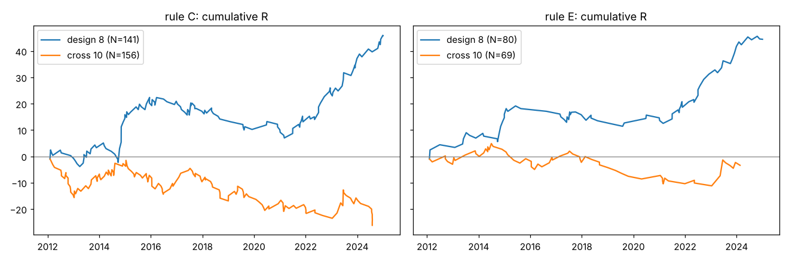

# ボリンジャーバンド±2σタッチ＋RSIダイバージェンス（H4）ホールドアウト検証

対象期間 2012〜2024年（IS = 2012〜2018、OOS = 2019〜2024）、H4足、histdata 1分足からの再集計（EST）。コストは銘柄別の往復スプレッド＋スリッページ（bt.COST_PIPS、変更なし）。R = 損益 ÷ 初期リスク（エントリー〜損切り幅）。

## 1. 結論

- 設計に使っていないクロス通貨10銘柄では、ルールCは **N=156、平均 −0.168R、勝率30.8%、合計 −26.2R、t=−1.50** でした。設計時の8銘柄（+0.325R）とは符号が逆で、合格基準（平均+0.15R以上ほか5項目）を一つも満たしていません。
- ルールA〜Dのどれも、クロス10銘柄ではIS・OOSの両方でマイナスです。
- 原因を調べ、フィルター候補30個を「設計8／クロス10 × IS／OOS」の4区分で検証しました（3回まで）。4区分すべてで改善したのは2個（H4 ADX<30、D1でSMA20から1ATR以上離れた逆張り）だけでした。この2個を加えたルールEでも、クロス10銘柄は **N=69、平均 −0.049R、t=−0.26** で、基準を満たしません。
- **判定：このシグナルは他の銘柄に通用しません。** 設計8銘柄で出たプラスは、銘柄と期間がたまたま合った結果である可能性が高いと考えます。実際の取引に使える形で残ったルールはありません。

## 2. クロス通貨10銘柄での結果（ルールA〜D）

対象：EURJPY GBPJPY EURGBP AUDJPY EURAUD EURCHF CADJPY AUDNZD NZDJPY GBPCHF（どれもルール設計には使っていません）。1銘柄につき同時に持つポジションは1つまで。

| ルール | N | 平均R | 勝率 | 合計R | t値 | 最大DD(R) | IS平均R | OOS平均R | プラス銘柄 | 合計R/｜DD｜ |
|---|---:|---:|---:|---:|---:|---:|---:|---:|---:|---:|
| A：全シグナル | 528 | −0.115 | 39.6% | −60.9 | −2.21 | −66.9 | −0.093 | −0.146 | 3/10 | −0.91 |
| B：12本以内の2回目以降 | 194 | −0.189 | 33.0% | −36.7 | −2.03 | −35.8 | −0.211 | −0.155 | 3/10 | −1.03 |
| C：B＋損切り幅≦1.5ATR | 156 | −0.168 | 30.8% | −26.2 | −1.50 | −25.1 | −0.162 | −0.178 | 4/10 | −1.04 |
| D：C＋バンド幅パーセンタイル<0.6 | 89 | −0.227 | 30.3% | −20.2 | −1.59 | −19.1 | −0.193 | −0.285 | 3/10 | −1.06 |

合格基準のチェック（ルールC、クロス10銘柄）

| 基準 | 必要な値 | 結果 | 判定 |
|---|---|---:|---|
| 平均R | +0.15R以上 | −0.168 | 不合格 |
| t値 | 1.5以上 | −1.50 | 不合格 |
| プラス銘柄数 | 10銘柄中6以上 | 4 | 不合格 |
| IS・OOS | どちらもプラス | −0.162 ／ −0.178 | 不合格 |
| 合計R／｜最大DD｜ | 2以上 | −1.04 | 不合格 |

ルールCの銘柄別（クロス10銘柄）

| 銘柄 | AUDJPY | AUDNZD | CADJPY | EURAUD | EURCHF | EURGBP | EURJPY | GBPCHF | GBPJPY | NZDJPY |
|---|---:|---:|---:|---:|---:|---:|---:|---:|---:|---:|
| 件数 | 13 | 17 | 9 | 16 | 8 | 17 | 14 | 19 | 20 | 23 |
| 平均R | −0.34 | −0.09 | +0.12 | −0.31 | +0.31 | +0.12 | +0.14 | −0.18 | −0.45 | −0.45 |
| 合計R | −4.37 | −1.61 | +1.09 | −4.98 | +2.44 | +2.06 | +1.94 | −3.44 | −9.04 | −10.29 |

ルールA・B・Dの銘柄別平均R（クロス10銘柄）

| ルール | AUDJPY | AUDNZD | CADJPY | EURAUD | EURCHF | EURGBP | EURJPY | GBPCHF | GBPJPY | NZDJPY |
|---|---:|---:|---:|---:|---:|---:|---:|---:|---:|---:|
| A | −0.19 | −0.13 | −0.21 | −0.45 | −0.14 | +0.04 | +0.11 | +0.20 | −0.26 | −0.21 |
| B | −0.40 | −0.09 | +0.10 | −0.31 | −0.16 | +0.06 | +0.08 | −0.25 | −0.39 | −0.33 |
| D | −0.40 | −0.20 | +0.53 | −0.51 | −0.09 | +0.24 | +0.31 | −0.82 | −0.62 | −0.22 |

ルールCの年別（クロス10銘柄）

| 年 | 2012 | 2013 | 2014 | 2015 | 2016 | 2017 | 2018 | 2019 | 2020 | 2021 | 2022 | 2023 | 2024 |
|---|---:|---:|---:|---:|---:|---:|---:|---:|---:|---:|---:|---:|---:|
| 件数 | 17 | 13 | 16 | 16 | 15 | 11 | 10 | 12 | 8 | 11 | 6 | 11 | 10 |
| 平均R | −0.86 | +0.49 | +0.34 | −0.28 | −0.17 | +0.01 | −0.62 | +0.05 | −0.34 | −0.13 | −0.51 | +0.60 | −1.04 |
| 合計R | −14.64 | +6.40 | +5.48 | −4.47 | −2.50 | +0.08 | −6.24 | +0.58 | −2.70 | −1.39 | −3.05 | +6.65 | −10.40 |

方向別（ルールC、クロス）：売り 77件 平均−0.24R、買い 79件 平均−0.10R。

## 3. 設計時8銘柄との比較

設計8銘柄（EURUSD GBPUSD USDJPY AUDUSD USDCAD USDCHF NZDUSD XAUUSD）を同じコードで再計算し、これまでの数値と一致することを確認しました。

| ルール | 設計8 N | 設計8 平均R | 設計8 IS／OOS | クロス10 N | クロス10 平均R | クロス10 IS／OOS |
|---|---:|---:|---|---:|---:|---|
| A | 437 | +0.031 | +0.008 ／ +0.063 | 528 | −0.115 | −0.093 ／ −0.146 |
| B | 180 | +0.285 | +0.145 ／ +0.485 | 194 | −0.189 | −0.211 ／ −0.155 |
| C | 141 | +0.325 | +0.171 ／ +0.546 | 156 | −0.168 | −0.162 ／ −0.178 |
| D | 92 | +0.363 | +0.046 ／ +0.813 | 89 | −0.227 | −0.193 ／ −0.285 |

- ルールCの平均Rの差は0.49R、Welchのt値は2.92です。二つのグループの差は偶然のばらつきだけでは説明しにくい大きさです。
- 18銘柄をまとめたルールCは N=297、平均 +0.066R、t=0.78、IS −0.010／OOS +0.184 です。統計的に意味のある値ではありません。

## 4. 診断（なぜクロス通貨で駄目なのか）

| 観点 | 設計8 | クロス10 | 読み取れること |
|---|---|---|---|
| コスト（ルールC、1トレードあたりのR） | 0.037R | 0.052R | クロスのほうが0.015R重いだけ。コストを引く前でもクロスは −0.116R（設計 +0.362R）。**コストは主因ではありません** |
| 2回目以降のシグナル（k≧1）と初回（k=0）の比較（重複を含む全シグナル） | k=0 +0.032R ／ k≧1 +0.266R | k=0 −0.112R ／ k≧1 −0.228R | **ルールの中心である「2回目以降を取る」効果が、クロスでは逆向き**です。ISでもOOSでも同じでした（クロスIS：k=0 −0.102／k≧1 −0.251、クロスOOS：−0.125／−0.189） |
| 利確・損切りの割合（ルールC） | 利確 45%／損切り 52% | 利確 29%／損切り 69% | クロスでは逆張りの戻りが弱く、損切りまで伸びてしまうことが多い |
| 円クロス（ルールC） | — | 円クロス 79件 −0.26R、円以外 77件 −0.07R | 円クロスは2022〜2024年に 15件 −0.71R（−10.7R）。ただし2021年までは円クロスも円以外も同じくらい悪い（−0.16R／−0.14R）。**円安トレンドの影響もありますが、それだけでは説明がつきません** |
| 方向（ルールC） | 売り +0.33／買い +0.32 | 売り −0.24／買い −0.10 | どちらの方向でもマイナス。片方だけを取るルールにしても救えません |
| D1での逆張りの深さ（SMA20からの乖離、ATR単位） | 深いほど良い（0〜1：0.00、1〜2：+0.28、2以上：+0.47） | どの区間もマイナス（−0.27、−0.17、−0.14） | 向きは同じですが、クロスではそもそも水準がマイナス |

まとめると、クロス通貨では元のシグナル（ルールA）がすでに −0.115R でした。そのうえ、設計時に効果があった「クラスタの2回目以降」という条件が、クロスでは逆に成績を悪くしています。設計8銘柄での優位性は、主にこの条件から生まれていました。この条件が他の銘柄で再現しないため、ルール全体が通用しないということです。

## 5. 試したフィルター一覧

採用の基準：ルールCにフィルターを加えたとき、平均Rが4区分（設計IS、設計OOS、クロスIS、クロスOOS）**すべてで**改善すること。18銘柄合計で約100件以上の取引が残ること。閾値は1つの特徴量につき2個まで、きりのよい数字だけを使いました。かっこ内は件数です。

### 第1回（ベース＝ルールC）

| フィルター | N(18銘柄) | 平均R | 設計IS | 設計OOS | クロスIS | クロスOOS | 改善した区分 | 判定 |
|---|---:|---:|---:|---:|---:|---:|---:|---|
| ベース：ルールC | 297 | +0.066 | +0.171 (83) | +0.546 (58) | −0.162 (98) | −0.178 (58) | — | — |
| F01 2回目の安値（売りは高値）が1回目から0.5ATR未満 | 237 | +0.088 | +0.172 (69) | +0.507 (48) | −0.166 (82) | −0.045 (38) | 2/4 | 不採用 |
| F02 同 1.0ATR未満 | 282 | +0.088 | +0.216 (80) | +0.571 (57) | −0.181 (93) | −0.157 (52) | 3/4 | 不採用 |
| F03 バンド外に連続2本以下 | 137 | +0.066 | +0.267 (45) | +0.489 (22) | −0.291 (44) | −0.036 (26) | 2/4 | 不採用 |
| F04 バンド外に連続3本以下 | 242 | +0.102 | +0.172 (75) | +0.590 (47) | −0.212 (77) | +0.009 (43) | 3/4 | 不採用 |
| F05 シグナル時RSIが25〜40（売りは60〜75） | 270 | +0.059 | +0.143 (74) | +0.593 (53) | −0.180 (90) | −0.189 (53) | 1/4 | 不採用 |
| F06 シグナル時RSIが30以上（極端でない） | 179 | +0.027 | −0.130 (49) | +0.806 (39) | −0.304 (60) | −0.064 (31) | 2/4 | 不採用 |
| F07 20:00 EST足を除外 | 267 | +0.071 | +0.195 (73) | +0.573 (57) | −0.219 (86) | −0.179 (51) | 2/4 | 不採用 |
| F08 バンド幅パーセンタイル<0.6（＝ルールD） | 181 | +0.073 | +0.046 (54) | +0.813 (38) | −0.193 (56) | −0.285 (33) | 1/4 | 不採用 |
| F09 バンド幅パーセンタイル<0.8 | 239 | +0.067 | +0.107 (68) | +0.623 (49) | −0.225 (78) | −0.096 (44) | 2/4 | 不採用 |
| F10 シグナル足の値幅≦1.5ATR | 281 | +0.073 | +0.181 (80) | +0.565 (55) | −0.180 (94) | −0.157 (52) | 3/4 | 不採用 |
| F11 シグナル足の値幅≦2.0ATR | 293 | +0.071 | +0.185 (82) | +0.546 (58) | −0.185 (97) | −0.147 (56) | 2/4 | 不採用 |
| F12 D1 ATR比<1.2 | 249 | +0.074 | +0.015 (65) | +0.610 (53) | −0.158 (81) | −0.042 (50) | 3/4 | 不採用 |
| F13 D1 ATR比<1.5 | 285 | +0.071 | +0.177 (78) | +0.546 (58) | −0.164 (91) | −0.178 (58) | 1/4 | 不採用 |
| F14 利確（ミドルバンド）まで1.0ATR以上 | 295 | +0.074 | +0.171 (83) | +0.546 (58) | −0.143 (96) | −0.178 (58) | 1/4 | 不採用 |
| F15 利確まで1.5ATR以上 | 282 | +0.076 | +0.198 (78) | +0.541 (57) | −0.186 (91) | −0.142 (56) | 2/4 | 不採用 |
| F16 利確幅／損切り幅≧1.0 | 291 | +0.063 | +0.168 (80) | +0.541 (57) | −0.163 (96) | −0.178 (58) | 0/4 | 不採用 |
| F17 終値が足の下半分（売りは上半分） | 249 | +0.039 | +0.196 (68) | +0.565 (47) | −0.166 (84) | −0.325 (50) | 2/4 | 不採用 |
| F18 終値が足の下1/3（売りは上1/3） | 194 | +0.088 | +0.273 (55) | +0.679 (35) | −0.229 (68) | −0.171 (36) | 3/4 | 不採用 |
| F19 前日D1の実体（絶対値）<1.0 D1ATR | 258 | +0.010 | +0.095 (74) | +0.638 (49) | −0.254 (81) | −0.279 (54) | 1/4 | 不採用 |
| F20 前日D1の実体（絶対値）<1.5 D1ATR | 288 | +0.052 | +0.167 (81) | +0.574 (57) | −0.229 (92) | −0.178 (58) | 1/4 | 不採用 |
| F21 直近3日間の逆行が3 D1ATR未満 | 297 | +0.066 | ベースと同じ | | | | 0/4 | 不採用（該当なし） |
| F22 基準点のRSIが30未満（売りは70超） | 293 | +0.056 | +0.133 (81) | +0.546 (58) | −0.163 (96) | −0.178 (58) | 0/4 | 不採用 |
| F23 基準点のRSIが35未満 | 297 | +0.066 | ベースと同じ | | | | 0/4 | 不採用（該当なし） |
| F24 RSIダイバージェンス幅≧10 | 75 | −0.030 | −0.191 (13) | +0.934 (15) | −0.205 (30) | −0.447 (17) | 1/4 | 不採用 |
| F25 基準点からの更新幅<1.0ATR | 178 | +0.057 | +0.018 (47) | +0.698 (38) | −0.151 (61) | −0.247 (32) | 2/4 | 不採用 |
| **F26 H4 ADX<30（強いトレンド中は逆張りしない）** | 182 | +0.179 | +0.242 (46) | +0.657 (48) | −0.140 (59) | −0.063 (29) | **4/4** | **採用** |
| F27 D1 ADX<30 | 202 | −0.017 | −0.015 (53) | +0.504 (35) | −0.122 (72) | −0.275 (42) | 1/4 | 不採用 |
| **F28 D1終値がSMA20から逆張り方向に1 D1ATR以上離れている** | 261 | +0.116 | +0.243 (75) | +0.621 (50) | −0.121 (85) | −0.169 (51) | **4/4** | **採用** |
| F29 H4 ATR比<1.2 | 210 | +0.079 | +0.120 (60) | +0.640 (46) | −0.145 (67) | −0.280 (37) | 2/4 | 不採用 |
| F30 円クロスを除外（結果を見てから決めた条件なので参考のみ） | 218 | +0.185 | +0.171 (83) | +0.546 (58) | −0.189 (53) | +0.188 (24) | 1/4 | 不採用 |

注意：30個の候補のうち、4区分すべてで改善したのは2個でした。改善の向きがでたらめに出るとしても、4区分そろう確率は1/16なので、30個試せば約1.9個は偶然そろいます。つまり**採用した2個も、偶然と区別できるほどの根拠はありません**。F28は、設計時に「深い逆張りほど良い」と分かっていた点を条件にしたものです。

### 第2回（ベース＝ルールE＝C＋F26＋F28）

ベース：N=149、平均 +0.275R、設計IS +0.338 (40)、設計OOS +0.773 (40)、クロスIS −0.069 (47)、クロスOOS −0.007 (22)。

同じ候補を再び試しましたが、4区分すべてで改善したものはありませんでした。3/4にとどまったものは F04（バンド外連続3本以下）、F09（バンド幅パーセンタイル<0.8）、F17・F18（終値の位置）、F25（更新幅<1.0ATR）、F29（H4 ATR比<1.2）です。どれもクロスISかクロスOOSのどちらかで悪化しました。たとえばF25では、クロスISが −0.003 にとどまり、ベースに対して −0.015 でした。全候補の数値は out/filters_C_x.csv にあります。**追加の採用はありません**。

### 第3回（ベースの構造の見直し）

「2回目以降」の条件がクロスで逆向きだったため、F26とF28を別のベースでも試しました。

| ベース | ベースの4区分（設計IS／設計OOS／クロスIS／クロスOOS） | F26の改善区分 | F28の改善区分 | ベース＋F26＋F28 |
|---|---|---:|---:|---|
| A：全シグナル | +0.008／+0.063／−0.093／−0.146 | 3/4（設計OOSで悪化） | 3/4（クロスOOSで悪化） | N=451、平均 0.000R、クロス −0.108 |
| A＋損切り幅≦1.5ATR | +0.117／+0.085／−0.148／−0.154 | 3/4 | 3/4 | N=361、平均 +0.090R、クロス −0.070 |
| B | +0.145／+0.485／−0.211／−0.155 | 4/4 | 4/4 | N=184、平均 +0.181R、クロス −0.067 |

F26とF28は、ベースを変えると効果が安定しません。どのベースでも、クロス10銘柄はマイナスのままでした。ここで見直しを打ち切りました（上限の3回）。

## 6. 最終ルール（ルールE）とその成績

ルールE＝ルールC＋次の2条件（すべて確定足で判定するため、先読みはありません）
- シグナル足のH4 ADX(14)が30未満
- D1の確定足で、終値がSMA20から逆張り方向に1 D1ATR以上離れていること（買いならSMA20より1ATR以上下、売りなら1ATR以上上）

**ルールEも合格基準を満たしていません。** 下の表は「最善の候補でもこの程度」という記録であり、取引を勧めるものではありません。

| 対象 | N | 平均R | 勝率 | 合計R | t値 | 最大DD(R) | IS平均R | OOS平均R | プラス銘柄 | 合計R/｜DD｜ |
|---|---:|---:|---:|---:|---:|---:|---:|---:|---:|---:|
| 18銘柄合計 | 149 | +0.275 | 45.0% | +41.0 | 2.16 | −17.7 | +0.118 | +0.497 | 11/18 | 2.32 |
| 設計8 | 80 | +0.555 | 55.0% | +44.4 | 3.31 | −7.7 | +0.338 | +0.773 | 7/8 | 5.75 |
| クロス10 | 69 | −0.049 | 33.3% | −3.4 | −0.26 | −16.1 | −0.069 | −0.007 | 4/10 | −0.21 |

クロス10銘柄での基準判定：平均R −0.049（不合格）、t −0.26（不合格）、プラス銘柄 4/10（不合格）、IS・OOSともマイナス（不合格）、合計R/｜DD｜ −0.21（不合格）。

18銘柄合計の +0.275R は、ほぼ設計8銘柄の分（+44.4R）だけで出ています。設計8銘柄は、ルールを決めるときにも、フィルターを選ぶときにも使ったデータです。このため数字は実力より良く見えています。

ルールEの年別

| 年 | 2012 | 2013 | 2014 | 2015 | 2016 | 2017 | 2018 | 2019 | 2020 | 2021 | 2022 | 2023 | 2024 |
|---|---:|---:|---:|---:|---:|---:|---:|---:|---:|---:|---:|---:|---:|
| 18銘柄 件数 | 10 | 11 | 18 | 10 | 10 | 18 | 10 | 7 | 4 | 18 | 10 | 15 | 8 |
| 18銘柄 合計R | +1.38 | +6.58 | +10.72 | −1.47 | −1.51 | −2.20 | −3.25 | −5.18 | +0.94 | +2.23 | +12.80 | +18.37 | +1.62 |
| 設計8 合計R | +4.39 | +2.53 | +9.07 | +2.11 | −1.02 | −1.31 | −2.28 | −0.85 | +1.96 | +4.03 | +12.54 | +10.56 | +2.70 |
| クロス10 合計R | −3.02 | +4.05 | +1.65 | −3.58 | −0.50 | −0.88 | −0.97 | −4.33 | −1.02 | −1.79 | +0.26 | +7.81 | −1.08 |

ルールEの銘柄別（件数／平均R／合計R）

| 設計8 | AUDUSD | EURUSD | GBPUSD | NZDUSD | USDCAD | USDCHF | USDJPY | XAUUSD |
|---|---:|---:|---:|---:|---:|---:|---:|---:|
| 件数 | 12 | 16 | 10 | 8 | 7 | 10 | 9 | 8 |
| 平均R | +0.65 | +0.72 | +1.15 | +0.83 | −0.62 | +0.03 | +0.64 | +0.65 |
| 合計R | +7.79 | +11.52 | +11.50 | +6.67 | −4.34 | +0.34 | +5.75 | +5.22 |

| クロス10 | AUDJPY | AUDNZD | CADJPY | EURAUD | EURCHF | EURGBP | EURJPY | GBPCHF | GBPJPY | NZDJPY |
|---|---:|---:|---:|---:|---:|---:|---:|---:|---:|---:|
| 件数 | 6 | 6 | 3 | 9 | 4 | 6 | 4 | 8 | 8 | 15 |
| 平均R | −0.07 | −0.04 | +0.69 | −0.33 | +0.45 | +0.96 | +0.26 | −0.48 | −0.28 | −0.29 |
| 合計R | −0.39 | −0.26 | +2.08 | −2.98 | +1.79 | +5.74 | +1.03 | −3.83 | −2.22 | −4.36 |

方向別：設計8は売り46件 +0.41R、買い34件 +0.75R。クロス10は売り38件 −0.27R、買い31件 +0.22R。

## 7. 取引しない条件の最終リスト

実務上の結論は「**このインジケーターでは取引しない**」です。それでも使う場合に、最低限これだけは避けるべきという条件を挙げます。ただし、これらの条件を守ってもプラスになるという保証は、ホールドアウトでは得られていません。

1. M15・H1足では使わない（どの設定でも優位性なし）。
2. H4でも、クロス通貨（特に円クロス）では使わない。ルールCでもEでもマイナスでした。円クロスは2022〜2024年にルールCで15件 −10.7Rです。
3. クラスタの1回目のシグナルは取らない。ただし「2回目以降なら良い」という部分は、クロスでは成り立ちませんでした（k≧1 のほうが悪い）。
4. 損切り幅が1.5ATRを超えるなら見送る。
5. H4 ADXが30以上（強いトレンドの最中）なら見送る（4区分で改善したが、偶然と区別できない）。
6. D1でSMA20から1ATR以上離れていない、浅い逆張りなら見送る（同上）。
7. 試したものの効果が確認できなかった条件：バンド幅、20時足、足の値幅、D1 ATR比、利確までの距離、終値の位置、前日の大陽線・大陰線、RSIの水準、ダイバージェンス幅、2回目の更新幅、D1 ADX。これらで見送るかどうかを決めても意味がありません。

## 8. 限界

- 1グループあたり、ルールCで約150件、ルールEで70〜80件しかありません。1トレードの標準偏差が約1.5Rなので、平均Rの標準誤差は0.12〜0.18Rになります。設計8銘柄の +0.3〜0.5R も、誤差の幅はかなり広いです。
- クロス10銘柄は、第1回のフィルター選定ですでに使いました。このため、ルールEのクロス成績（−0.049R）も厳密な意味での未使用データではなく、むしろ良く見えている可能性があります。それでもマイナスでした。
- クロス通貨は互いに、またドルストレートとも相関があり（円クロス同士など）、銘柄を独立したサンプルとは見なせません。
- コストは固定の想定値です。実際のスプレッドは時間帯や相場の荒れ方で広がります（特にクロス通貨とロールオーバー時間帯）。スワップは含めていません。
- データはhistdataの1分足だけで、別のデータ提供元との照合はしていません。AUDJPYは2012年10月からです。
- ポジションは1銘柄につき1つまで、銘柄間の同時保有の制限やリスク配分は、最大DD(R)の計算に反映していません（表のcagr1/maxdd1は1%リスク・最大4ポジションでの参考値で、out/holdout_iter_summary.csv にあります）。

## 再現方法とファイル

- `python3 -I code/holdout.py cross EURJPY GBPJPY EURGBP AUDJPY EURAUD EURCHF CADJPY AUDNZD NZDJPY GBPCHF`（ログ：out/holdout_cross.log）
- `python3 -I code/holdout.py design EURUSD GBPUSD USDJPY AUDUSD USDCAD USDCHF NZDUSD XAUUSD`（ログ：out/holdout_design.log）
- `python3 -I code/hx_diag.py`（診断）
- `python3 -I code/hx_filters.py C`（第1回、out/filters_C.csv）、`python3 -I code/hx_filters.py C "(x.adx < 30) & (-x.dir * x.d1_dist20 >= 1)"`（第2回、out/filters_C_x.csv）、ベースA／A15／Bでも同様（第3回）
- `python3 -I code/holdout_iter.py`（ルールA〜Eの最終集計、out/holdout_iter.log、out/holdout_iter_summary.csv、out/trades_ruleE_*.parquet、out/holdout_cumR.png）
- 注：設計8のルールCの最大DDは、holdout.py では −15.3R、holdout_iter.py では −15.4R です。同じ時刻のトレードの並び順が違うだけで、取引内容は同じです。
